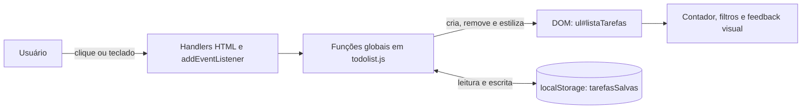
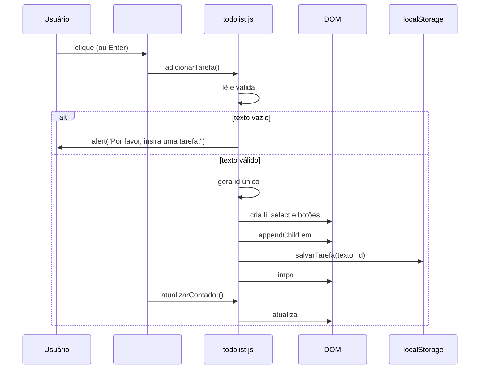
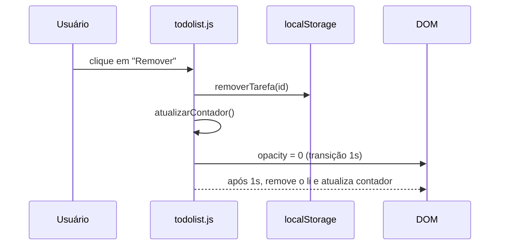
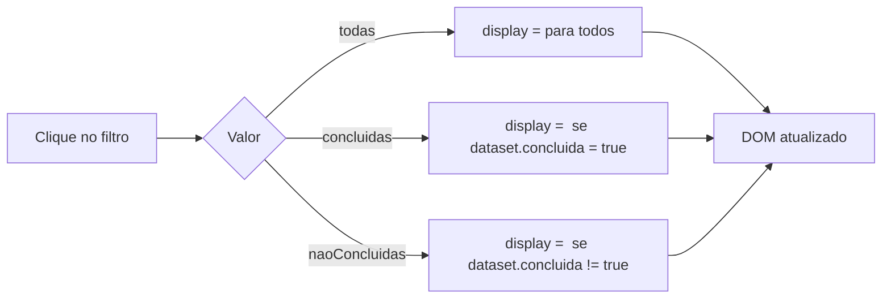
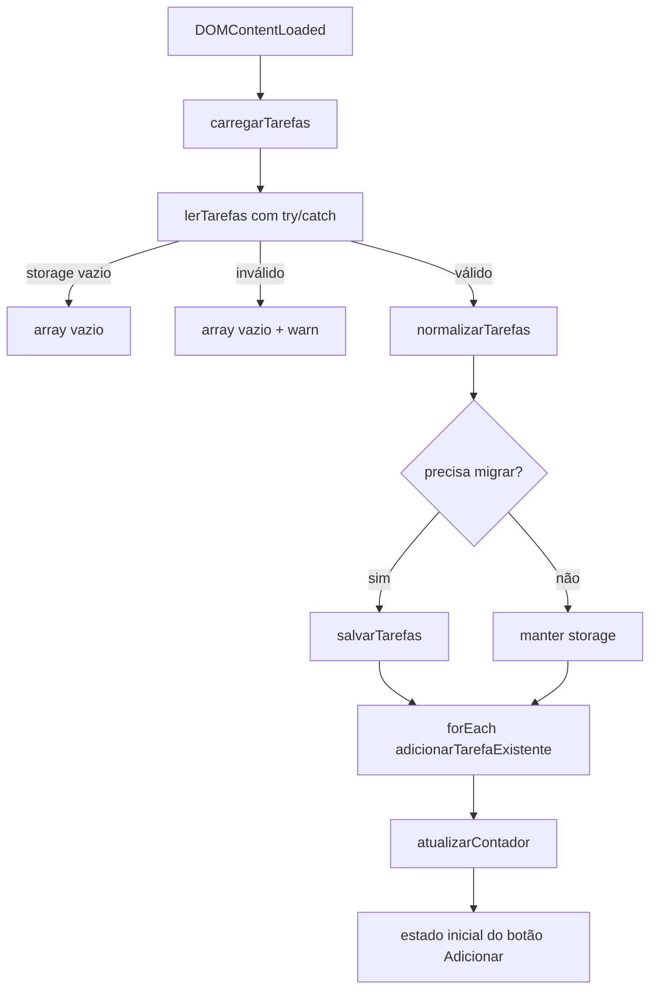

# Lista de Tarefas (OrganizaAi)

**Documentação técnica e executiva**

| Item | Valor |
|---|---|
| Projeto | OrganizaAi — Lista de Tarefas |
| Tipo | Aplicação web estática, single-page, sem build |
| Stack | HTML5, CSS3, JavaScript (ES6+) |
| Persistência | `localStorage` do navegador |
| Dependências | Nenhuma |
| Repositório | `github.com/dsant-code71/OrganizaAi` |
| Documento gerado em | 28/10/2026 |
| Revisão | 2 — correções P1 aplicadas em 28/10/2026 |
| Base analisada | `todolist.js` da working tree (modificado em relação ao último commit) |

---

## Sumário

1. [Sumário executivo](#1-sumário-executivo)
2. [Escopo e objetivos](#2-escopo-e-objetivos)
3. [Stack e requisitos](#3-stack-e-requisitos)
4. [Estrutura do repositório](#4-estrutura-do-repositório)
5. [Execução e deploy](#5-execução-e-deploy)
6. [Arquitetura](#6-arquitetura)
7. [Modelo de dados](#7-modelo-de-dados)
8. [Referência de funções](#8-referência-de-funções)
9. [Fluxos operacionais](#9-fluxos-operacionais)
10. [Funcionalidades e cobertura dos exercícios](#10-funcionalidades-e-cobertura-dos-exercícios)
11. [Regras de UI e comportamento](#11-regras-de-ui-e-comportamento)
12. [Análise de bugs e riscos](#12-análise-de-bugs-e-riscos)
13. [Segurança](#13-segurança)
14. [Acessibilidade](#14-acessibilidade)
15. [Desempenho e escalabilidade](#15-desempenho-e-escalabilidade)
16. [Roadmap técnico priorizado](#16-roadmap-técnico-priorizado)
17. [Checklist de validação manual](#17-checklist-de-validação-manual)
18. [Apêndices](#18-apêndices)

---

## 1. Sumário executivo

O `OrganizaAi` é uma aplicação de lista de tarefas (to-do list) construída em HTML, CSS e JavaScript puros, sem frameworks, sem dependências externas e sem etapa de compilação. O produto final é executado diretamente no navegador e persiste as tarefas no `localStorage`.

O projeto tem origem didática: os arquivos `tarefas.md` (20 exercícios de manipulação de DOM) e `ref js.md` (material de referência de JavaScript e DOM) definem o roteiro de evolução. O código implementa a maior parte desse roteiro, incluindo CRUD parcial, conclusão de tarefas, prioridades, filtros, contador, animações e persistência.

### 1.1 Estado atual

| Indicador | Valor |
|---|---|
| Arquivos de aplicação | 3 (`index.html`, `todolist.css`, `todolist.js`) |
| Linhas de aplicação | 423 (37 HTML + 94 CSS + 292 JS) |
| Funcionalidades principais | 10 |
| Exercícios totalmente implementados | 12 de 20 |
| Exercícios parcialmente implementados | 3 de 20 |
| Exercícios pendentes | 5 de 20 |
| Bugs/riscos catalogados | 20 |
| Bugs resolvidos | 5 (B01, B02, B03, B07, B15) |
| Bugs de prioridade alta (P1) pendentes | 0 (3 corrigidos em 28/10/2026) |
| Testes automatizados | Nenhum |
| Lint/typecheck configurado | Nenhum |
| Build/deploy automatizado | Nenhum |

### 1.2 Pontos fortes

- Funciona sem instalação, servidor ou dependências.
- Persistência local simples e funcional.
- Interface objetiva, com feedback visual por prioridade, filtros e animações.
- Uso de `innerText` para conteúdo digitado pelo usuário, mitigando XSS.
- Código compacto e de fácil leitura para o porte do projeto.

### 1.3 Principais riscos

| Risco | Severidade | Status | Efeito |
|---|---|---|---|
| `contador--` referenciava variável inexistente | Alta | Resolvido | Linha removida; remoção não gera mais `ReferenceError` |
| Texto da tarefa usado como identificador único | Alta | Resolvido | `id` único, migração automática e operações por `id` |
| `JSON.parse` sem tratamento de erro no `localStorage` | Alta | Resolvido | Helpers `lerTarefas`/`salvarTarefas` com `try/catch` e fallback |
| Estado de conclusão não aplica estilo visual na tarefa | Média | Pendente | Requisitos 10/18 não atendidos; recarregamento não restaura visual |
| Prioridade não ordena a lista | Média | Pendente | Requisito 12 atendido apenas parcialmente |
| Botão "Adicionar" não volta ao estado desabilitado após adicionar | Média | Pendente | Usuário pode clicar com campo vazio e receber `alert` |
| Layout sem `overflow` para listas longas | Média | Pendente | Conteúdo pode ficar inacessível em telas pequenas |

### 1.4 Recomendação executiva

O projeto é adequado para uso pessoal e para fins de estudo. As correções críticas de robustez (contador, identidade das tarefas e parsing do storage) já foram aplicadas e validadas. A próxima etapa recomendada é concluir os requisitos visuais e funcionais pendentes do bloco P1 do [roadmap](#16-roadmap-técnico-priorizado): estilo de tarefas concluídas, ordenação por prioridade, paleta de texto por prioridade e exercícios 6, 9, 16, 17 e 18.

---

## 2. Escopo e objetivos

### 2.1 Objetivo do produto

Permitir que o usuário crie, visualize, conclua, priorize, filtre e remova tarefas em uma única página, mantendo os dados entre recarregamentos por meio do `localStorage`.

### 2.2 Objetivo didático

Exercitar manipulação de DOM sem frameworks, cobrindo:

- seleção de elementos;
- criação, inserção e remoção de nós;
- eventos de clique, teclado e formulário;
- atributos `data-*`;
- estilos dinâmicos;
- persistência com `localStorage`;
- lógica de filtros e contadores.

### 2.3 Dentro do escopo

- Adição de tarefas por botão e pela tecla Enter.
- Remoção individual com animação.
- Marcação de conclusão.
- Prioridade por tarefa com diferenciação visual.
- Filtros "Todas", "Concluídas" e "Não Concluídas".
- Contador total de tarefas.
- Limpeza total da lista e do storage.
- Persistência local.

### 2.4 Fora do escopo

- Autenticação e multiusuário.
- Sincronização com servidor ou banco de dados.
- Edição de texto de tarefas (exercícios 6 e 9).
- Ordenação automática por prioridade.
- Exportação/importação de dados.
- Testes automatizados, lint e build.
- Acessibilidade completa (ARIA, navegação por teclado avançada).

> Observação: o arquivo `AdamSmith.Md`, que continha um documento de visão do projeto R-Financeiro sem relação com esta aplicação, foi removido do repositório conforme decisão do responsável.

---

## 3. Stack e requisitos

| Camada | Tecnologia | Observação |
|---|---|---|
| Marcação | HTML5 | `index.html` |
| Estilo | CSS3 | `todolist.css` + estilos inline aplicados via JS |
| Comportamento | JavaScript ES6+ | `todolist.js` |
| Persistência | Web Storage API (`localStorage`) | Chave `tarefasSalvas` |
| Build | Nenhum | Arquivos servidos como estão |
| Testes | Nenhum | Validação manual |
| Dependências | Nenhuma | Sem `package.json` |

### 3.1 Requisitos de ambiente

- Navegador moderno com suporte a ES6, `dataset`, `localStorage`, `forEach`, `map`, `filter` e template literals.
- Não requer Node.js, servidor de aplicação ou instalação de pacotes.
- Recomenda-se servir via HTTP para comportamento consistente do `localStorage`; o modo `file://` também funciona na maioria dos navegadores.

### 3.2 Compatibilidade

| Recurso | Suporte |
|---|---|
| Chrome/Edge | Sim |
| Firefox | Sim |
| Safari | Sim |
| Navegadores sem `localStorage` (modo restrito/privado) | Falha não tratada |
| Execução via `file://` | Sim, com possíveis diferenças de origem no storage |

---

## 4. Estrutura do repositório

```text
OrganizaAi/
├── index.html          # Estrutura da página e handlers inline
├── todolist.css        # Estilos visuais e layout
├── todolist.js         # Toda a lógica de estado, DOM e persistência
├── tarefas.md          # 20 exercícios de DOM que orientam o projeto
├── ref js.md           # Material de referência de JavaScript/DOM
└── DOCUMENTACAO.md     # Este documento
```

### 4.1 Responsabilidade dos arquivos

| Arquivo | Linhas | Responsabilidade |
|---|---:|---|
| `index.html` | 37 | Define contêiner, input, botão adicionar, contador, filtros, lista e área de limpeza. Carrega `todolist.css` e `todolist.js`. |
| `todolist.css` | 94 | Define tema escuro, layout centralizado, estilos de input, botões, lista e itens. |
| `todolist.js` | 292 | Inicialização, CRUD, prioridades, conclusão, filtros, contador, animações, migração e persistência. |
| `tarefas.md` | 225 | Especificação dos 20 exercícios. |
| `ref js.md` | 252 | Referência de sintaxe e APIs usadas nos exercícios. |

### 4.2 Ausências relevantes

- Sem `package.json`, `README.md` (antes deste documento), `.gitignore`, configuração de lint, testes ou CI.
- Sem separação de módulos: todo o JavaScript está em um único arquivo e exposto no escopo global.

---

## 5. Execução e deploy

### 5.1 Execução local

Opção 1 — abrir diretamente:

```text
Abrir index.html no navegador.
```

Opção 2 — servidor HTTP local (recomendado):

```bash
python -m http.server 8000
```

Acessar `http://localhost:8000`.

### 5.2 Deploy

O projeto é estático e pode ser publicado em qualquer hospedagem de arquivos:

- GitHub Pages;
- Netlify;
- Vercel (como site estático);
- Cloudflare Pages;
- servidor HTTP convencional.

O histórico do Git contém commits de criação e remoção de um arquivo `CNAME`, indicando uso prévio de domínio customizado em GitHub Pages. No estado atual não há `CNAME` nem workflow de deploy no repositório.

### 5.3 Observações operacionais

- Os dados ficam no navegador do usuário, por origem. Limpar dados do site remove as tarefas.
- Não há backup, exportação ou migração de dados.
- Mudanças de schema contam com normalização e migração implícita no carregamento; não há envelope versionado nem migrações incrementais.

---

## 6. Arquitetura

### 6.1 Visão geral

A aplicação adota uma arquitetura monolítica de página única, com estado distribuído entre DOM e `localStorage`. Não há camada de estado formal, roteamento ou separação entre modelo, visão e controlador.



### 6.2 Elementos do DOM

| ID / Seletor | Elemento | Origem | Função |
|---|---|---|---|
| `tarefaInput` | `input[type=text]` | HTML | Entrada do texto da tarefa |
| `addBtn` | `button` | HTML | Adiciona tarefa; possui `onclick` inline |
| `count` | `div` | HTML | Exibe o total de tarefas |
| `divFiltros` | `div` | HTML, populado por JS | Contém os botões de filtro |
| `listaTarefas` | `ul` | HTML | Contêiner das tarefas |
| `divLimpar` | `div` | HTML, populado por JS | Contém o botão "Limpar" |
| `btnLimpar` | `button` | JS | Remove todas as tarefas |
| `btnTodas` | `button` | JS | Filtro "Todas" |
| `btnConcluidas` | `button` | JS | Filtro "Concluídas" |
| `btnNaoConcluidas` | `button` | JS | Filtro "Não Concluídas" |
| `#listaTarefas li` | `li` | JS | Item de tarefa, com `select` e dois botões |

Cada `li` contém:

1. texto da tarefa (via `innerText`);
2. `select` de prioridade (`nenhuma`, `alta`, `média`, `baixa`);
3. botão "Remover";
4. botão "Concluir"/"Concluída".

### 6.3 Inicialização

A ordem de execução é relevante:

```text
1. Navegador parseia o HTML.
2. Ao final do <body>, todolist.js é carregado e executado.
3. Statements de topo de arquivo executam imediatamente:
   - registram o listener de Enter no input;
   - injetam o botão "Limpar" em #divLimpar;
   - injetam os botões de filtro em #divFiltros;
   - aplicam estilos de grid em #divFiltros.
4. O evento DOMContentLoaded dispara:
   - carregarTarefas() lê o localStorage e recria os itens;
   - o botão "Adicionar" é desabilitado;
   - um listener de input controla o estado do botão.
```

Esse desenho depende de o script estar no fim do `<body>`. Se for movido para o `<head>` sem `defer`, os acessos diretos a elementos no topo do arquivo falharão.

### 6.4 Padrões adotados

| Padrão | Uso |
|---|---|
| Funções globais | Toda a lógica é declarada no escopo global |
| Handlers inline | `onclick` em `#addBtn`, `#btnLimpar` e botões de filtro |
| DOM como fonte de verdade | Contador e filtros derivam do estado atual do DOM |
| Estilos inline | Prioridade e conclusão alteram `style` diretamente |
| Persistência read-modify-write | Cada operação lê o array completo, altera e regrava |
| Identificador por `id` | Cada tarefa recebe um `id` único, persistido no storage e em `dataset.id` |
| Migração automática | Registros antigos sem `id` são normalizados e regravados no carregamento |
| Animação por `setTimeout` | Fade in/out baseado em opacidade e tempo fixo |

### 6.5 Limitações arquiteturais

- Duas fontes de verdade (DOM e `localStorage`) sem sincronização transacional.
- Ausência de estado centralizado e de renderização declarativa.
- Regras de negócio acopladas à criação de elementos.
- Impossibilidade de testar funções isoladamente sem simular DOM e storage.

---

## 7. Modelo de dados

### 7.1 Storage

| Item | Valor |
|---|---|
| API | `localStorage` |
| Chave | `tarefasSalvas` |
| Formato | JSON array |
| Escopo | Origem da página |
| Versionamento | Inexistente |

### 7.2 Schema atual

```json
[
  {
    "id": "7f3c2a1e-8b4d-4c2a-9f1e-3d5b6a7c8d9e",
    "texto": "Estudar DOM",
    "concluida": false,
    "prioridade": "nenhuma"
  },
  {
    "id": "1a2b3c4d-5e6f-4a7b-8c9d-0e1f2a3b4c5d",
    "texto": "Entregar relatório",
    "concluida": true,
    "prioridade": "alta"
  }
]
```

| Campo | Tipo | Valores | Origem |
|---|---|---|---|
| `id` | string | UUID ou fallback único | `gerarId()` |
| `texto` | string | Texto digitado | Input |
| `concluida` | boolean | `true` / `false` | Botão de conclusão |
| `prioridade` | string | `nenhuma`, `alta`, `média`, `baixa` | `select` de prioridade |

### 7.3 Propriedades e restrições

- O array preserva a ordem de inserção.
- `id` é único por tarefa; ids duplicados ou ausentes são corrigidos no carregamento.
- `texto` não é mais usado como identificador; tarefas com o mesmo texto são independentes.
- `média` é armazenado com acento; comparações e `switch` dependem dessa grafia exata.
- Tarefas são criadas com `prioridade: "nenhuma"` em `salvarTarefa`; a prioridade só é persistida após interação no `select`.
- `concluida` é persistido como boolean; valores legados `"true"`/`"false"` são normalizados.
- Não há campos de `createdAt`, `updatedAt` ou `version`.
- Cada escrita substitui o array inteiro.
- A leitura valida o formato do array e descarta entradas sem `texto` válido.
- Storage corrompido não quebra a aplicação; a leitura retorna um array vazio e registra aviso.
- Dados de versões futuras continuam sujeitos a normalização e perda de campos desconhecidos.

### 7.4 Operações sobre o modelo

| Operação | Implementação | Observação |
|---|---|---|
| Criar | `salvarTarefa` (`todolist.js:193`) | `push` de um novo objeto com `id` |
| Atualizar conclusão | `atualizarTarefa` (`:199`) | `map` por igualdade de `id`; grava boolean |
| Atualizar prioridade | `atualizarTarefa` (`:199`) | Mesma função, com `prioridade` atual |
| Remover | `removerTarefa` (`:211`) | `filter` por desigualdade de `id` |
| Limpar | `limparTarefas` (`:239`) | `removeItem` da chave |
| Carregar | `carregarTarefas` (`:219`) | Leitura segura, normalização, migração e recriação de nós |

### 7.5 Evolução recomendada (v3)

A versão atual já possui `id` e normalização, mas mantém um array plano sem versionamento. Para evoluções futuras, recomenda-se um envelope versionado:

```json
{
  "version": 3,
  "tasks": [
    {
      "id": "7f3c2a1e-...",
      "text": "Estudar DOM",
      "done": false,
      "priority": "alta",
      "createdAt": "2026-10-28T12:00:00.000Z",
      "updatedAt": "2026-10-28T12:05:00.000Z"
    }
  ]
}
```

Benefícios: migração explícita entre versões, auditoria básica e evolução de schema sem ambiguidade.

---

## 8. Referência de funções

| Função | Linhas | Entrada | Efeito | Persiste |
|---|---|---:|---|---|
| `gerarId` | 4–9 | — | Gera UUID via `crypto.randomUUID` ou fallback `Date.now` + `Math.random` | Não |
| `normalizarTarefa` | 11–18 | `tarefa` | Garante `id`, boolean `concluida` e prioridade válida | Não |
| `normalizarTarefas` | 20–33 | `tarefas` | Normaliza o array e elimina ids duplicados | Não |
| `lerTarefas` | 35–50 | — | Lê o storage com `try/catch`, valida o array e filtra entradas inválidas | Leitura |
| `salvarTarefas` | 52–58 | `tarefas` | Serializa e grava o array com `try/catch` | Sim |
| `atualizarContador` | 60–63 | — | Conta `li` em `#listaTarefas` e escreve `Tarefas: N` em `#count`; emite `console.log` | Não |
| `adicionarTarefa` | 88–99 | — | Gera `id`, cria item, salva e limpa o campo | Sim, via `salvarTarefa` |
| `adicionarTarefaExistente` | 101–170 | `tarefaTexto`, `concluida=false`, `prioridade="nenhuma"`, `id=null` | Cria `li`, `select` e botões, registra listeners e insere na lista | Indiretamente, via handlers |
| `aplicarEstiloPrioridade` | 172–191 | `tarefa`, `prioridade` | Aplica `backgroundColor` e `color` inline | Não |
| `salvarTarefa` | 193–197 | `tarefaTexto`, `id` | Adiciona `{id, texto, concluida:false, prioridade:"nenhuma"}` ao array | Sim |
| `atualizarTarefa` | 199–209 | `id`, `concluida`, `prioridade` | Substitui o registro com o mesmo `id`; normaliza `concluida` para boolean | Sim |
| `removerTarefa` | 211–217 | `id` | Remove o registro com o mesmo `id` e atualiza o contador | Sim |
| `carregarTarefas` | 219–237 | — | Lê, normaliza, migra se necessário e recria os itens | Leitura/escrita na migração |
| `limparTarefas` | 239–247 | — | Esvazia `#listaTarefas`, remove a chave do storage e atualiza o contador | Sim |
| `filtrarTarefas` | 268–291 | `filtro` (`todas`, `concluidas`, `naoConcluidas`) | Alterna `display` dos `li` conforme `dataset.concluida` | Não |

### 8.1 Handlers registrados

| Evento | Elemento | Linhas | Ação |
|---|---|---:|---|
| `DOMContentLoaded` | `document` | 65–86 | Carrega tarefas, desabilita botão e registra listener de input |
| `input` | `#tarefaInput` | 75–85 | Habilita/desabilita `#addBtn` e altera cor/cursor |
| `click` | `#addBtn` (inline) | `index.html:14` | `adicionarTarefa()` e `atualizarContador()` |
| `click` | Botão "Remover" | 118–126 | Remove do storage por `id`, anima saída, remove nó e atualiza contador |
| `click` | Botão "Concluir" | 131–144 | Alterna estado, altera cores do botão e persiste por `id` |
| `change` | `select` de prioridade | 159–163 | Atualiza prioridade, estilo e storage por `id` |
| `keypress` | `#tarefaInput` | 249–253 | Adiciona tarefa ao pressionar Enter |
| `click` | `#btnLimpar` (inline) | 255 | `limparTarefas()` |
| `click` | Botões de filtro (inline) | 258–262 | `filtrarTarefas(filtro)` |

### 8.2 Observações

- `adicionarTarefa` recebe um argumento no handler de Enter (`:251`), mas ignora o parâmetro; o valor é relido do input.
- `adicionarTarefaExistente` é usada tanto para criação nova quanto para reidratação do storage; o `id` é sempre preservado.
- `carregarTarefas` migra registros antigos sem `id`, prioridade inválida ou `concluida` em string.
- O listener de prioridade atualiza a variável de closure `prioridade`, usada nas chamadas subsequentes de `atualizarTarefa`.
- Não há `classList` nem classes de estado; todo o visual é inline.

---

## 9. Fluxos operacionais

### 9.1 Adicionar tarefa



Observações:

- O botão permanece habilitado após a adição, pois a limpeza do input é programática e não dispara o evento `input`.
- Handlers inline chamam `adicionarTarefa()` e `atualizarContador()` em sequência.

### 9.2 Remover tarefa



- O registro é removido do storage imediatamente pelo `id`.
- A remoção visual ocorre após 1 segundo.
- Não há mais `ReferenceError`: a linha `contador--` foi removida.
- Duplicatas de texto são independentes; remover uma não afeta a outra.

### 9.3 Concluir e alterar prioridade

```mermaid
flowchart TD
    A[Clique em Concluir] --> B{dataset.concluida === "true"?}
    B -->|Sim| C[Botão volta a Concluir, fundo escuro, texto ciano]
    B -->|Não| D[Botão vira Concluída, fundo verde, texto preto]
    C --> E[atualizarTarefa id, estado, prioridade]
    D --> E
    E --> F[localStorage atualizado com boolean]

    G[change no select] --> H[aplicarEstiloPrioridade]
    H --> I[atualizarTarefa]
    I --> F
```

- O estado de conclusão altera apenas o botão, não o fundo/texto do `li`.
- A prioridade altera o fundo e a cor do texto do `li`.
- A prioridade não reordena a lista.
- Ao recarregar, o rótulo do botão reflete o estado salvo, mas as cores do botão não são reaplicadas.

### 9.4 Filtrar



- O filtro é apenas visual; não remove nem altera dados.
- O filtro ativo não é persistido e não é indicado visualmente.
- O contador continua contando itens ocultos, o que está alinhado ao requisito de total.

### 9.5 Carregar



---

## 10. Funcionalidades e cobertura dos exercícios

### 10.1 Funcionalidades entregues

| Funcionalidade | Status | Evidência |
|---|---|---|
| Adicionar tarefa | Implementado | `todolist.js:88-99`, `:101-170` |
| Remover tarefa individual | Implementado | `:118-126`, `:211-217` |
| Marcar/desmarcar conclusão | Implementado com desvio | `:131-144` |
| Limpar lista | Implementado | `:239-247`, `:255-256` |
| Contador total | Implementado | `:60-63` |
| Editar texto | Pendente | — |
| Animação de entrada/saída | Implementado | `:110-113`, `:120-125` |
| Adicionar com Enter | Implementado | `:249-253` |
| Edição inline | Pendente | — |
| Filtros | Implementado | `:258-291` |
| Prioridade por tarefa | Parcial | `:146-163` |
| Persistência em `localStorage` | Implementado | `:193-237` |
| Estado do botão por input | Implementado com desvio | `:65-86` |
| Cores de fundo por prioridade | Implementado | `:172-191` |
| Fundo da página por quantidade | Pendente | — |
| Cor do botão remover por status | Pendente | — |
| Estilo de tarefa concluída | Pendente | — |
| Cor de texto por prioridade | Parcial | `:172-191` |
| Transições | Implementado | `:110-113`, `:120-125` |

### 10.2 Matriz dos 20 exercícios

| # | Exercício | Status | Evidência / observação |
|---:|---|---|---|
| 1 | Adicionar nova tarefa | Implementado | Cria `li`, insere e limpa input (`:88-99`, `:101-170`) |
| 2 | Remover tarefa | Implementado | Botão remove do DOM e do storage por `id` (`:118-126`, `:211-217`) |
| 3 | Marcar como concluída | Implementado com desvio | Usa botão e estilos inline; não usa `classList` nem clique no texto (`:131-144`) |
| 4 | Limpar lista | Implementado | `limparTarefas` (`:239-247`) |
| 5 | Contar tarefas | Implementado | Conta todos os `li`, inclusive ocultos por filtro (`:60-63`) |
| 6 | Alterar texto da tarefa | Pendente | Sem `prompt` ou edição |
| 7 | Animação adicionar/remover | Implementado | Fade de opacidade (`:110-113`, `:120-125`) |
| 8 | Adicionar com Enter | Implementado | `keypress` (`:249-253`) |
| 9 | Edição inline | Pendente | Sem substituição por input |
| 10 | Estilo distinto para concluídas | Parcial | Apenas o botão muda de cor; o `li` não (`:131-144`) |
| 11 | Filtros | Implementado | Três filtros por `dataset.concluida` (`:258-291`) |
| 12 | Prioridade | Parcial | `select` e cor implementados; ordenação ausente (`:146-163`) |
| 13 | Persistência | Implementado | `salvar`, `atualizar`, `remover`, `carregar` (`:193-237`) |
| 14 | Botão conforme preenchimento | Implementado com desvio | Desabilita vazio, mas usa preto em vez de verde e não reavalia após adicionar (`:65-86`, `:95`) |
| 15 | Fundo por prioridade | Implementado | `aplicarEstiloPrioridade` (`:172-191`) |
| 16 | Fundo da página por quantidade | Pendente | Sem lógica |
| 17 | Cor do botão remover por status | Pendente | Botão sem estilo condicional |
| 18 | Estilo de concluídas | Pendente | Sem fundo suave nem `line-through` |
| 19 | Cor do texto por prioridade | Parcial | Cor dinâmica existe, mas o texto é preto, não vermelho/laranja/verde |
| 20 | Transições suaves | Implementado | Fade in/out (`:110-113`, `:120-125`) |

### 10.3 Resultado consolidado

| Status | Quantidade | Exercícios |
|---|---:|---|
| Implementado | 12 | 1, 2, 3, 4, 5, 7, 8, 11, 13, 14, 15, 20 |
| Parcial | 3 | 10, 12, 19 |
| Pendente | 5 | 6, 9, 16, 17, 18 |

---

## 11. Regras de UI e comportamento

### 11.1 Prioridade

| Valor | Fundo do `li` | Cor do texto | Efeito |
|---|---|---|---|
| `nenhuma` | `#000000` | `#05cdff` | Padrão |
| `alta` | `#f34040` | `#000000` | Vermelho |
| `média` | `#fca33d` | `#000000` | Laranja/amarelo |
| `baixa` | `#59fc61` | `#000000` | Verde |

- O `select` é criado por tarefa, com opções `Nenhuma`, `Alta`, `Média`, `Baixa`.
- O valor é convertido para minúsculas (`toLowerCase`) ao popular as opções.
- A prioridade não altera a ordem dos itens.
- A prioridade é persistida na mesma operação da conclusão.

### 11.2 Conclusão

| Estado | Rótulo do botão | Fundo do botão | Cor do texto |
|---|---|---|---|
| Pendente | `Concluir` | `#0f0f0f` | `#05cdff` |
| Concluída | `Concluída` | `#05ff5d` | `#000000` |

- O estado é armazenado em `dataset.concluida` (`"true"`/`"false"`) e persistido no storage como boolean.
- Ao carregar, valores legados em string são normalizados para boolean.
- O `li` não recebe classe ou estilo de concluído.
- Ao carregar, o rótulo é corrigido, mas as cores do botão não.

### 11.3 Filtros

| Filtro | Critério |
|---|---|
| Todas | Exibe todos os `li` |
| Concluídas | Exibe apenas `dataset.concluida === "true"` |
| Não Concluídas | Exibe apenas `dataset.concluida !== "true"` |

### 11.4 Contador

- Texto exibido: `Tarefas: N`.
- `N` é a quantidade de `li` em `#listaTarefas`.
- Itens ocultos por filtro continuam sendo contados.
- Durante o fade de remoção, o item ainda conta até ser removido do DOM.

### 11.5 Botão "Adicionar"

| Situação | Estado | Cor | Cursor |
|---|---|---|---|
| Inicial | Desabilitado | Cinza | `not-allowed` |
| Input com texto | Habilitado | `#0f0f0f` | `pointer` |
| Input vazio (após digitar) | Desabilitado | Cinza | `not-allowed` |
| Após adicionar | Permanece habilitado | `#0f0f0f` | `pointer` |

### 11.6 Animações

- Entrada: opacidade inicia em `0`, transição de `1s` após `setTimeout(..., 1)`.
- Saída: opacidade vai a `0`, remoção do nó após `1s`.
- Não há `prefers-reduced-motion`.

### 11.7 Tema visual

- Fundo da página: `#0f0f0f`.
- Contêiner: `#252525`, largura máxima `400px`, borda arredondada `8px`.
- Destaque: `#05cdff`.
- Input escuro com borda preta.
- Lista em grid de três colunas (`50% 25% 25%`).

---

## 12. Análise de bugs e riscos

### 12.1 Escala de severidade

| Nível | Critério |
|---|---|
| P0 | Impede o uso ou causa perda de dados |
| P1 | Funcionalidade principal incorreta, erro em runtime ou quebra de carregamento |
| P2 | Desvio de requisito, problema de UX ou robustez |
| P3 | Qualidade de código, manutenção ou estética |

### 12.2 Catálogo

| ID | Sev. | Status | Local | Descrição | Impacto | Recomendação |
|---|---|---|---|---|---|---|
| B01 | P1 | Resolvido | `todolist.js:118-126` | `contador--` referenciava variável inexistente | `ReferenceError` a cada remoção | Linha removida; contador recalculado pelo DOM |
| B02 | P1 | Resolvido | `todolist.js:4-58`, `:193-217` | `texto` era usado como chave única | Duplicatas removidas/atualizadas em conjunto | `id` único e operações por `id` |
| B03 | P1 | Resolvido | `todolist.js:35-58` | `JSON.parse` sem `try/catch` | Storage corrompido quebrava o carregamento | Helpers `lerTarefas`/`salvarTarefas` com fallback |
| B04 | P2 | Pendente | `todolist.js:95`, `:65-86` | Input é limpo via JS, sem disparar `input` | Botão continua habilitado com campo vazio após adicionar | Extrair `atualizarEstadoBotao()` e chamar após limpar |
| B05 | P2 | Pendente | `todolist.js:131-144`, `:219-237` | Conclusão altera apenas o botão | Tarefa concluída não tem visual distinto; recarregamento não restaura cores | Aplicar classe `.completed` e reaplicar no load |
| B06 | P2 | Pendente | `todolist.js:146-163` | Prioridade não ordena a lista | Requisito 12 incompleto | Ordenar por peso (`alta` > `média` > `baixa` > `nenhuma`) |
| B07 | P2 | Resolvido | `todolist.js:211-217` | `atualizarContador()` era chamado duas vezes seguidas | Redundância e contagem intermediária inconsistente | Chamada duplicada removida |
| B08 | P2 | Pendente | `todolist.css:2-10`, `:71-80` | `body` com `height: 100vh` e sem `overflow` | Listas longas ficam cortadas/inacessíveis | Usar `min-height`, `overflow-y: auto` |
| B09 | P2 | Pendente | `todolist.js:172-191` | Cor do texto por prioridade é sempre preta nas coloridas | Requisito 19 não atendido na paleta pedida | Definir cores solicitadas ou documentar desvio |
| B10 | P2 | Pendente | `todolist.js:159-163` | Prioridade é aplicada, mas não há reorganização | Itens de alta prioridade não sobem | Reordenar o DOM ou renderizar a partir de estado ordenado |
| B11 | P2 | Pendente | `index.html:13-14`, `todolist.js:249` | Sem `<label>` e sem `aria-live` no contador | Acessibilidade limitada | Adicionar labels, `aria-label` e `aria-live` |
| B12 | P3 | Pendente | `todolist.css:20` | `display: g` é declaração inválida | Ignorada pelo navegador | Remover ou corrigir para `grid` |
| B13 | P3 | Pendente | `todolist.css:82-93` | Classe `.remove-btn` não é usada | Código morto | Remover ou aplicar a classe |
| B14 | P3 | Pendente | `index.html:14`, `todolist.js:255-262` | Handlers inline | Acoplamento e restrição de CSP | Migrar para `addEventListener` |
| B15 | P3 | Resolvido | `todolist.js:1` | Expressão string vazia isolada | Ruído no arquivo | Removida |
| B16 | P3 | Pendente | `todolist.js:62` | `console.log` em produção | Ruído no console | Remover ou condicionar a ambiente de debug |
| B17 | P3 | Pendente | `todolist.js:239-247` | Limpeza sem confirmação | Perda acidental de todas as tarefas | Adicionar confirmação |
| B18 | P3 | Pendente | `todolist.js:249` | `keypress` obsoleto e argumento ignorado | Baixa manutenibilidade | Usar `keydown` e remover argumento |
| B19 | P3 | Pendente | `todolist.js:193-197` | Prioridade inicial fixa em `"nenhuma"` | Impede criação já priorizada | Aceitar prioridade no `salvarTarefa` |
| B20 | P3 | Pendente | `todolist.js:268-291` | Filtro não persistido nem indicado | Usuário não sabe o filtro ativo após interações | Adicionar estado visual e persistência |

### 12.3 Correções aplicadas (P1)

#### B01 — `contador--` indefinido

Causa: `contador` só existia como variável local em `atualizarContador`; a leitura de um identificador não declarado lançava `ReferenceError` ao final do handler de remoção.

Correção aplicada: a linha `contador--` foi removida. O contador é recalculado por `atualizarContador()` após a remoção do nó. Não há mais exceção no fluxo de remoção.

#### B02 — Texto como chave primária

Causa: `atualizarTarefa` e `removerTarefa` comparavam `tarefa.texto`, tratando tarefas com o mesmo texto como o mesmo registro.

Correção aplicada:

- `gerarId()` cria UUID via `crypto.randomUUID()` com fallback baseado em `Date.now()` e `Math.random()`.
- Cada tarefa recebe `id` no storage e em `dataset.id`.
- `salvarTarefa`, `atualizarTarefa` e `removerTarefa` operam exclusivamente por `id`.
- `normalizarTarefas()` garante unicidade e regenera ids duplicados.
- `carregarTarefas()` detecta registros legados e regrava o array migrado.

Resultado: tarefas com texto idêntico podem ser concluídas, priorizadas e removidas de forma independente.

#### B03 — `JSON.parse` sem proteção

Causa: todas as operações chamavam `JSON.parse` diretamente e assumiam que o resultado era um array válido.

Correção aplicada:

- `lerTarefas()` encapsula leitura, parsing e validação em `try/catch`.
- Valores não-array, JSON inválido e entradas sem `texto` válido resultam em lista vazia e aviso no console.
- `salvarTarefas()` protege a escrita contra `SecurityError` e `QuotaExceededError`.
- A normalização converte `concluida` em boolean e valida a prioridade contra `PRIORIDADES_VALIDAS`.
- Storage corrompido não impede mais a inicialização da lista nem o registro do listener de input.

#### B07 — Contador duplicado

A chamada duplicada de `atualizarContador()` em `removerTarefa` foi removida. O contador continua sendo recalculado após a remoção visual do nó pelo handler.

#### Validação executada

Os cenários abaixo foram validados com um harness temporário em Node.js, simulando DOM e `localStorage`:

1. storage corrompido mantém a aplicação operacional;
2. migração de tarefas antigas sem `id`;
3. conclusão independente de tarefas com texto duplicado;
4. remoção independente de tarefas com texto duplicado;
5. adição com `id` consistente entre DOM e storage;
6. remoção sem `ReferenceError`;
7. normalização de `"true"`/`"false"` e prioridade inválida;
8. correção de ids duplicados no storage.

Todos os cenários passaram. O harness não foi incorporado ao repositório; não há suíte de testes automatizados permanente.

### 12.4 Dívida técnica

- Estado e renderização acoplados.
- Estilos de estado inline em vez de classes.
- Funções globais sem namespaces.
- Ausência de testes permanentes e de contratos de dados.
- Falta de versionamento do storage.
- Handlers inline dificultam CSP e testes.
- Layout sem tratamento de listas longas.

---

## 13. Segurança

### 13.1 Superfície de ataque

| Vetor | Situação |
|---|---|
| XSS via texto da tarefa | Mitigado: uso de `innerText` (`todolist.js:105`) |
| XSS via `innerHTML` | Restrito a strings estáticas (`todolist.js:255`, `:258-262`) |
| Requisições externas | Nenhuma |
| Cookies/tokens | Nenhum |
| Execução remota | Nenhuma |
| Dados sensíveis | Não armazenados por padrão |

### 13.2 `localStorage`

- Acessível a qualquer script da mesma origem.
- Sem criptografia.
- Sem expiração.
- Sujeito a limpeza pelo navegador.
- Pode ser manipulado pelo usuário; o app valida o formato básico e normaliza os campos conhecidos.

### 13.3 Content Security Policy

O uso de handlers inline (`onclick`) impede uma CSP restritiva sem `unsafe-inline` para scripts. Recomenda-se migrar todos os handlers para `addEventListener` antes de adotar CSP rigorosa.

### 13.4 Boas práticas já presentes

- Conteúdo do usuário inserido com `innerText`.
- Sem `eval`, `Function` ou `document.write`.
- Sem dependências de terceiros.

### 13.5 Recomendações

- Manter a validação de schema do storage em futuras migrações.
- Manter o tratamento de exceções de storage.
- Adicionar CSP após remover handlers inline.
- Se houver multiusuário no futuro, mover persistência para backend autenticado.

---

## 14. Acessibilidade

| Item | Situação | Recomendação |
|---|---|---|
| Label do input | Ausente | Adicionar `<label for="tarefaInput">` |
| Label do `select` de prioridade | Ausente | Adicionar `aria-label` descritivo por tarefa |
| Contador | Sem `aria-live` | Adicionar `aria-live="polite"` em `#count` |
| Filtros | Sem estado acessível | Usar `aria-pressed` e indicar filtro ativo |
| Estado de conclusão | Só visual e no rótulo do botão | Adicionar texto/atributo no item |
| Prioridade | Comunicada apenas por cor | Adicionar rótulo textual |
| Navegação por teclado | Botões e `select` são nativos | Garantir ordem lógica e foco visível |
| Contraste | Bom na maioria das combinações | Validar WCAG AA |
| Movimento | Sem respeito a `prefers-reduced-motion` | Adicionar media query |
| Mensagens de erro | `alert` nativo | Substituir por mensagem acessível inline |

---

## 15. Desempenho e escalabilidade

### 15.1 Complexidade

| Operação | Complexidade | Observação |
|---|---|---|
| Adicionar | O(1) + escrita O(n) | Regrava o array completo |
| Remover | O(n) + escrita O(n) | `filter` + serialização |
| Atualizar | O(n) + escrita O(n) | `map` + serialização |
| Contar | O(n) | `querySelectorAll` |
| Filtrar | O(n) | Itera todos os `li` |
| Carregar | O(n) | Recria todos os nós e listeners |

### 15.2 Avaliação

Para o volume típico de uma lista pessoal (dezenas a centenas de itens), o desempenho é adequado. Não há virtualização, debounce ou atualização incremental; listas muito grandes podem causar lentidão na renderização e na serialização.

### 15.3 Melhorias possíveis

- Manter estado em memória e renderizar de forma incremental.
- Usar `DocumentFragment` ao carregar.
- Delegar eventos no `ul` em vez de registrar listeners por item.
- Adiar persistência com debounce.
- Paginar ou virtualizar listas extensas.

---

## 16. Roadmap técnico priorizado

### 16.1 P0 — Correções críticas (concluídas)

| Item | Ação | Status | Critério de aceite |
|---|---|---|---|
| B01 | Remover `contador--` | Concluído | Nenhum erro no console ao remover |
| B02 | Introduzir `id` único por tarefa | Concluído | Duplicatas podem ser removidas/alteradas de forma independente |
| B03 | Helper seguro de leitura/escrita do storage | Concluído | Storage inválido não quebra a aplicação |
| B07 | Remover atualização duplicada do contador | Concluído | Sem chamadas duplicadas no mesmo fluxo |

### 16.2 P1 — Requisitos pendentes

| Item | Ação | Critério de aceite |
|---|---|---|
| B04 | Reavaliar estado do botão após adicionar | Campo vazio desabilita o botão imediatamente |
| B05 | Aplicar estilo `.completed` no `li` | Fundo suave e `line-through` ao concluir e após reload |
| B06 | Ordenar por prioridade | Alta no topo, depois média, baixa, nenhuma |
| B09 | Implementar paleta de texto do exercício 19 | Vermelho/laranja/verde conforme prioridade |
| Ex. 6 | Edição por `prompt` | Texto alterado e persistido |
| Ex. 9 | Edição inline com `input` + `blur` | Texto editável na lista |
| Ex. 16 | Fundo da página conforme quantidade | Fundo claro com lista vazia |
| Ex. 17 | Cor do botão remover por status | Vermelho pendente, verde concluída |
| Ex. 18 | Estilo visual de concluídas | Fundo suave + riscado |

### 16.3 P2 — Robustez e UX

- Confirmação antes de limpar a lista.
- Persistência e indicação do filtro ativo.
- Layout com `min-height` e `overflow-y`.
- Substituir `alert` por mensagens inline.
- Remover `console.log`.
- Corrigir CSS inválido e código morto.

### 16.4 P3 — Refatoração

- Separar em módulos (`storage.js`, `tasks.js`, `ui.js`, `main.js`).
- Centralizar estado e renderização.
- Usar event delegation.
- Migrar estilos inline para classes.
- Adicionar testes unitários (Vitest/Jest) e E2E (Playwright).
- Adicionar lint (ESLint) e formatação (Prettier).
- Adicionar CSP e migrar handlers inline.
- Implementar versionamento e migração do storage.
- Melhorar acessibilidade (ARIA, `prefers-reduced-motion`, foco).

---

## 17. Checklist de validação manual

| # | Caso | Passos | Esperado | Estado atual |
|---:|---|---|---|---|
| 1 | Adicionar vazio | Clicar em "Adicionar" sem texto | Alerta; nada é criado | Conforme (botão desabilitado no início) |
| 2 | Adicionar por clique | Digitar e clicar | Item criado, input limpo, contador 1 | Conforme, mas botão fica habilitado |
| 3 | Adicionar por Enter | Digitar e pressionar Enter | Item criado | Conforme |
| 4 | Remover | Clicar em "Remover" | Fade, remoção, contador atualizado | Conforme, sem erro no console |
| 5 | Concluir | Clicar em "Concluir" | Botão verde, rótulo "Concluída" | Conforme |
| 6 | Reabrir concluída | Recarregar página | Estado visual preservado | Parcial: rótulo sim, cores não |
| 7 | Prioridade | Selecionar "Alta" | Fundo vermelho | Conforme |
| 8 | Prioridade após reload | Recarregar | Prioridade preservada | Conforme |
| 9 | Ordenação por prioridade | Criar tarefas com prioridades diferentes | Alta no topo | Não conformidade |
| 10 | Duplicata — remover | Criar duas tarefas iguais e remover uma | Apenas uma removida | Conforme |
| 11 | Duplicata — concluir | Criar duas iguais e concluir uma | Apenas uma alterada | Conforme |
| 12 | Filtro concluídas | Concluir uma e filtrar | Apenas concluídas visíveis | Conforme |
| 13 | Filtro não concluídas | Filtrar | Apenas pendentes visíveis | Conforme |
| 14 | Filtro todas | Filtrar | Todas visíveis | Conforme |
| 15 | Contador com filtro | Filtrar e observar | Total permanece | Conforme (por design) |
| 16 | Limpar | Clicar em "Limpar" | Lista e storage vazios | Conforme, sem confirmação |
| 17 | Persistência | Recarregar após adicionar | Itens mantidos | Conforme |
| 18 | Storage corrompido | Inserir JSON inválido na chave | App continua funcional | Conforme |
| 19 | Lista longa | Criar muitos itens | Acesso a todos os itens | Não conformidade (overflow) |
| 20 | Tela estreita | Reduzir viewport | Layout utilizável | Parcial |

> A migração automática também foi validada para registros sem `id`, com ids duplicados, com `concluida` em string e com prioridade inválida.

### 17.1 Como inspecionar o storage

```js
// Console do navegador
JSON.parse(localStorage.getItem("tarefasSalvas"));
```

Para simular corrupção:

```js
localStorage.setItem("tarefasSalvas", "{invalido");
location.reload();
```

Para limpar:

```js
localStorage.removeItem("tarefasSalvas");
location.reload();
```

---

## 18. Apêndices

### A. APIs de DOM e Web usadas

| API | Uso |
|---|---|
| `document.getElementById` | Seleção de elementos por ID |
| `document.querySelectorAll` | Contagem e filtro de `li` |
| `document.createElement` | Criação de `li`, `button`, `select`, `option` |
| `appendChild` | Inserção de nós |
| `element.remove()` | Remoção de tarefa |
| `addEventListener` | Eventos de input, clique, change e teclado |
| `element.dataset` | Estado de conclusão por tarefa |
| `element.style` | Estilos dinâmicos de prioridade, conclusão e animação |
| `innerText` | Texto do usuário e rótulos |
| `innerHTML` | Injeção de botões estáticos |
| `setTimeout` | Sequenciamento de animações |
| `JSON.parse` / `JSON.stringify` | Serialização do storage |
| `localStorage` | Persistência local |
| `crypto.randomUUID` | Geração de identificador único, com fallback |

### B. Glossário

| Termo | Definição |
|---|---|
| DOM | Representação em árvore do documento HTML, manipulável por JavaScript |
| `localStorage` | Armazenamento chave-valor persistente por origem no navegador |
| `dataset` | Interface para atributos `data-*` |
| Event delegation | Técnica de registrar um listener no ancestral em vez de em cada filho |
| XSS | Injeção de script malicioso a partir de conteúdo não confiável |
| CSP | Content Security Policy, política de restrição de recursos |
| Read-modify-write | Padrão de ler o array completo, alterar e regravar |
| UUID | Identificador único universal usado como chave das tarefas |
| Migração | Normalização e regravação de dados antigos no carregamento |
| Fonte de verdade | Local onde o estado considerado correto reside |
| Dívida técnica | Custo futuro decorrente de escolhas de implementação |
| P0–P3 | Escala de prioridade de correção usada neste documento |

### C. Documentos relacionados

| Arquivo | Papel |
|---|---|
| `tarefas.md` | Especificação dos 20 exercícios de DOM |
| `ref js.md` | Referência de JavaScript e manipulação de DOM |
| `DOCUMENTACAO.md` | Este documento |

### D. Histórico resumido do Git

O repositório evoluiu de forma incremental, com commits que registram a implementação dos exercícios, a persistência, correções de interação e ajustes de contador. Os commits mais recentes incluem correções na lista e no contador, além de um merge da branch principal. Houve uso anterior de `CNAME` para GitHub Pages.

### E. Rastreabilidade exercício → código

| Exercício | Funções/linhas |
|---|---|
| 1 | `adicionarTarefa` 88–99; `adicionarTarefaExistente` 101–170 |
| 2 | Handler de remoção 118–126; `removerTarefa` 211–217 |
| 3 | Handler de conclusão 131–144 |
| 4 | `limparTarefas` 239–247 |
| 5 | `atualizarContador` 60–63 |
| 6 | Não implementado |
| 7 | Fade in 110–113; fade out 120–125 |
| 8 | Listener de Enter 249–253 |
| 9 | Não implementado |
| 10 | Handler de conclusão 131–144 (apenas botão) |
| 11 | Injeção de filtros 258–266; `filtrarTarefas` 268–291 |
| 12 | `select` 146–163; estilo 172–191 |
| 13 | `salvarTarefa` 193–197; `atualizarTarefa` 199–209; `carregarTarefas` 219–237 |
| 14 | Inicialização 65–86 |
| 15 | `aplicarEstiloPrioridade` 172–191 |
| 16 | Não implementado |
| 17 | Não implementado |
| 18 | Não implementado |
| 19 | `aplicarEstiloPrioridade` 172–191 (paleta divergente) |
| 20 | Fade in 110–113; fade out 120–125 |

### F. Suporte de armazenamento e migração

| Função | Linhas | Papel |
|---|---|---|
| `gerarId` | 4–9 | Identidade única |
| `normalizarTarefa` | 11–18 | Normalização de campos |
| `normalizarTarefas` | 20–33 | Unicidade de ids |
| `lerTarefas` | 35–50 | Leitura segura e validação |
| `salvarTarefas` | 52–58 | Escrita segura |
| `carregarTarefas` | 219–237 | Migração automática no boot |

---

## Conclusão

O `OrganizaAi` cumpre o papel de aplicação didática e de uso pessoal, com funcionalidades centrais operacionais e baixo custo de execução. As fragilidades críticas de robustez foram corrigidas: o erro de contador foi eliminado, as tarefas passaram a ter identidade única com migração automática e o storage é lido e escrito com tratamento de exceções.

Os riscos remanescentes são de natureza funcional e visual: estilo de tarefas concluídas, ordenação e paleta de prioridade, além dos exercícios 6, 9, 16, 17 e 18. A execução do bloco P1 do roadmap conclui esses requisitos; a refatoração P2/P3 deve ser considerada se houver intenção de evoluir a aplicação para uso contínuo ou de adicionar novos recursos.
